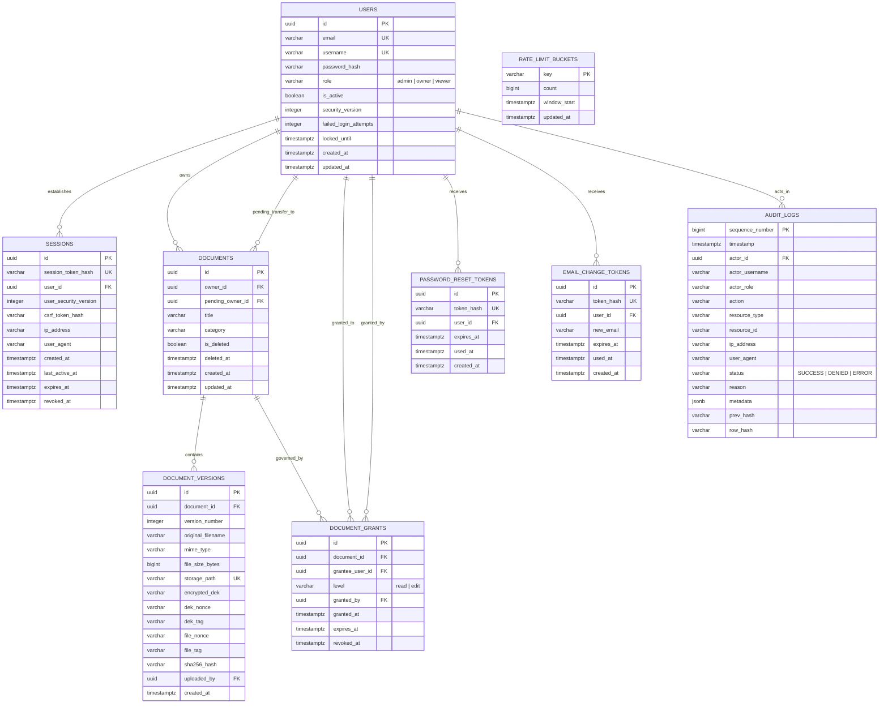

# TrustVault: Technical Architecture & Core System Design

## 1. System Overview

TrustVault is a zero-trust, high-assurance document sharing platform. The backend is designed as an authorisation and auditing engine where every state retrieval, search query, and content delivery must undergo deterministic mediation.

```
                           +-----------------------------------------------+
                           |          Client (React / Browser / CLI)       |
                           +-----------------------------------------------+
                                    |                        |
                   1. Session Cookie (httpOnly)      2. X-CSRF-Token
                   SameSite=Strict, Secure                   |
                                    v                        v
            +--------------------------------------------------------------------+
            |                  FastAPI Reverse Proxy & App Kernel               |
            |                                                                    |
            |  +------------------+  +-------------------+  +-----------------+  |
            |  | Security Headers |  | DB Rate Store     |  | CSRF Middleware |  |
            |  | (CSP, HSTS, etc.)|  | (Postgres-Backed) |  | (Double Submit) |  |
            |  +------------------+  +-------------------+  +-----------------+  |
            |                               |                                    |
            |                               v                                    |
            |           +----------------------------------------+               |
            |           | Central Authorisation: authorize()     |               |
            |           +----------------------------------------+               |
            |                               |                                    |
            |        +----------------------+----------------------+             |
            |        |                                             |             |
            |        v                                             v             |
            |  +--------------------------+          +-------------------------+ |
            |  | Document & Grant Service |          | Audit Logging Engine    | |
            |  | - Upload Validation      |          | - HMAC-SHA256 Chain     | |
            |  | - Full In-Memory Decrypt |          | - pg_advisory_xact_lock | |
            |  | - Decrypt Concurrency Cap|          | - External Git/Email Anc| |
            |  | - Pre-Send Auth Re-Check |          | - Aggregated Refusal Log| |
            |  | - Two-Step Transfer      |          |                         | |
            |  +--------------------------+          +-------------------------+ |
            +--------------------------------------------------------------------+
                         |                                           |
                         v                                           v
            +---------------------------+               +------------------------+
            | Encrypted Storage Path    |               | PostgreSQL 16+         |
            | (AES-256-GCM Ciphertext)  |               | App Role: trustvault_app
            | /var/trustvault/storage/  |               | Owner: trustvault_owner|
            +---------------------------+               +------------------------+
```

---

## 2. Authentication: Server-Side Revocable Sessions & Lifecycle

### Architectural Choice: Server-Side Revocable Sessions
TrustVault implements **server-side stateful sessions** backed by PostgreSQL, paired with **`httpOnly`**, **`Secure`**, **`SameSite=Strict`** cookies and **double-submit `X-CSRF-Token` headers**.

### Session Lifecycle & Hardening Rules
1. **Session ID Generation & Hashing:**
   - Session identifiers are generated via `secrets.token_urlsafe(32)` (256 bits of entropy).
   - Only the SHA-256 hash (`session_token_hash`) is persisted in the `sessions` table.
2. **Session Rotation on Login:**
   - On successful authentication, any prior active session for the user is terminated or explicitly rotated. A brand-new session token and CSRF secret are issued.
3. **Dual Expiration Windows:**
   - **Idle Timeout:** Session is rejected if `last_active_at + INTERVAL '30 minutes' < NOW()`. Every authenticated request updates `last_active_at`.
   - **Absolute Timeout:** Session expires unconditionally if `created_at + INTERVAL '12 hours' < NOW()`, preventing indefinite session persistence.
4. **Instant Invalidation via Security Versioning:**
   - Each user maintains an integer `security_version`.
   - The session record copies `user_security_version` at session creation.
   - When an account is disabled, a role is changed, a password is changed, or a password reset completes, `users.security_version` is incremented.
   - Any active session with a stale `user_security_version` is rejected immediately on the next request.
5. **Database-Backed Rate Limiting & Trusted Proxies:**
   - Rate limiting (login attempts, failed auth, refusal events) is managed strictly through database-backed atomic counters in PostgreSQL (`rate_limit_buckets` table). In-memory per-process stores are prohibited.
   - Client IP extraction trusts `X-Forwarded-For` headers **only** when the direct connection originates from a known, explicitly configured trusted reverse proxy (configured via `TRUSTED_PROXIES` CIDR list). Untrusted direct connections use `request.client.host` exclusively.
   - When refusal rate limiting engages, suppressed refusal attempts are tracked in the rate-limit store and flush as a single aggregated audit event (`REFUSALS_RATE_LIMITED_AGGREGATE` containing the actor/IP, count of suppressed events, and time window), ensuring refusals are never silently dropped.

---

## 3. Database Schema Specification

All timestamps use database server time (`NOW()` / `TIMESTAMPTZ`). All primary keys for domain entities use `UUIDv4`.



---

## 4. Central Authorisation Kernel (`authorize()`)

Every route and query delegates to `authorize()`. No endpoint executes ad-hoc permission logic.

### Canonical Access Rules:
1. **Deny by Default:** Any unrecognized condition or exception raises an authorization refusal.
2. **Existence Concealment (Consistent 404):**
   - If an actor has **no ownership and no active grant** on a document, the response is **`404 Not Found`** (`{"detail": "Document not found"}`).
   - If a document does not exist in the database, the response is **`404 Not Found`** (`{"detail": "Document not found"}`).
   - Both nonexistent and unauthorized document paths execute the identical query structure: querying with permission predicates (`WHERE id = :id AND (owner_id = :uid OR id IN (SELECT ...))`) and uniform refusal audit logging.
3. **Consistent 403 Forbidden:**
   - `403 Forbidden` is returned **only** when an actor's identity and existing relationship to the object are already established, but the requested action exceeds their granted capability (e.g. a grantee with `read` permission attempting to upload a new version or delete the document).
4. **Soft-Delete & Restore Lifecycle:**
   - If `document.is_deleted == TRUE`, all grantee requests return `404 Not Found`.
   - The document owner can see deleted documents only in a dedicated trash view.
   - Only the document owner can invoke `DOCUMENT_RESTORE`.
   - **Grant Preservation Rule:** Soft-deleting a document disables access for grantees while deleted. When the owner restores the document, prior unrevoked grants become active again **provided they have not expired** (`expires_at > NOW()`). Grants that expired during the deletion period remain expired; grants revoked before deletion remain revoked.
5. **Least-Privilege Administrator:**
   - Administrators (`role == 'admin'`) manage users, inspect system-wide audit logs, and monitor security dashboards.
   - Administrators possess **zero inherent access** to document contents or metadata. An admin requesting a document without an explicit grant receives `404 Not Found`, and the refusal is audited.

---

## 5. Storage, In-Memory Decryption & Direct Download Model

### In-Memory Decryption with Global Concurrency Cap
With the strict 25MB file size ceiling, TrustVault avoids streaming buffers and uses full in-memory decryption.
To protect server memory from exhaustion during concurrent downloads (e.g. 10 concurrent 25MB buffers = 250MB RAM), in-memory decryptions are guarded by an asynchronous semaphore concurrency cap (`MAX_CONCURRENT_DECRYPTS = 10`).

```
Download Request Flow:
1. GET /api/documents/{id}/download (Session Cookie + X-CSRF-Token)
        │
        â–¼
2. Initial authorize(actor, doc, Action.DOCUMENT_DOWNLOAD)
        │ (Passed)
        â–¼
3. Acquire Decrypt Concurrency Permit (asyncio Semaphore)
        │
        â–¼
4. Load Ciphertext from Disk & Encrypted DEK from DB
        │
        â–¼
5. Decrypt DEK using MASTER_KEY (from environment)
        │
        â–¼
6. Decrypt File Payload Fully in Memory (AES-256-GCM)
   AAD: document_id || ":" || version_id
        │
        â–¼
7. Verify AES-GCM Authentication Tag in Memory
   (If tag invalid -> Raise Tampering Error & Abort)
        │
        â–¼
8. RE-CHECK authorize(actor, doc, Action.DOCUMENT_DOWNLOAD)
   (Query DB: Is grant still unrevoked? Is user still active?)
        │
        ├─ If Revoked / Inactive ──► Release Permit, Return 404 & Audit Denial (Zero bytes sent)
        │
        â–¼ (Authorized)
9. Record Audit Log: Action DOCUMENT_DOWNLOAD (Signifies payload was RELEASED by server)
        │
        â–¼
10. Send HTTP 200 with Complete Payload & Security Headers:
    - Content-Disposition: attachment; filename="{sanitized_filename}"
    - Content-Type: application/octet-stream
    - X-Content-Type-Options: nosniff
    - Content-Security-Policy: default-src 'none'; sandbox
        │
        â–¼
11. Release Decrypt Concurrency Permit
```

### Download Audit Semantics
The audit event `DOCUMENT_DOWNLOAD` formally documents that **the file payload was released by the server** following successful authorization and decryption. It does **not** signify confirmed client-side receipt, as network disconnections or client abortions after bytes leave the server cannot be verified by the backend.

### Cryptographic Binding via Additional Authenticated Data (AAD)
During encryption, the AES-256-GCM cipher binds the ciphertext to the document and version identity:
$$\text{AAD} = \text{document\_id} \parallel \text{":"} \parallel \text{version\_id}$$
If ciphertext is swapped, renamed, or transplanted across documents or versions on disk, decryption fails authentication tag verification.

---

## 6. Audit Trail: HMAC-SHA256 Hash Chain & Concurrency Architecture

### Database Role Separation
Database privileges are strictly bifurcated between two distinct database roles:
1. **`trustvault_owner` (Schema & Migration Role):**
   - Owns the database schema, executes Alembic migrations, creates tables, and establishes triggers.
   - Used **only** during migration and setup scripts. The running application server never holds credentials for this role.
2. **`trustvault_app` (Runtime Application Role):**
   - Used by the FastAPI application backend during normal operations.
   - Permissions on `audit_logs`: `INSERT, SELECT` ONLY. `UPDATE, DELETE, TRUNCATE` are revoked.
   - Has **no permission** to alter tables, disable triggers, or drop database functions.

### Database Trigger Defense
An unconditional trigger on `audit_logs` prevents modifications:
```sql
CREATE OR REPLACE FUNCTION prevent_audit_tampering()
RETURNS TRIGGER AS $$
BEGIN
    RAISE EXCEPTION 'Audit trail is immutable: UPDATE and DELETE are prohibited on audit_logs';
END;
$$ LANGUAGE plpgsql;

CREATE TRIGGER trg_audit_logs_immutable
BEFORE UPDATE OR DELETE ON audit_logs
FOR EACH ROW EXECUTE FUNCTION prevent_audit_tampering();
```

### Cryptographic Hash Chain with External Key (HMAC-SHA256)
Plain SHA-256 is replaced with **HMAC-SHA256** using an external secret key (`AUDIT_HMAC_KEY`) held strictly outside the database in the application environment:

$$\text{row\_hash}_n = \text{HMAC-SHA256}\left(K_{\text{audit}}, \text{prev\_hash}_{n-1} \parallel \text{CanonicalPayload}_n\right)$$

- Because $K_{\text{audit}}$ is not stored in PostgreSQL, an attacker with direct database access cannot rewrite audit rows and re-calculate valid hashes.
- `CanonicalPayload` uses RFC 8785 deterministic JSON representation.
- **Audit Metadata Sanitization:** Audit metadata records **IDs only** (UUIDs for documents, versions, users, and grants). User-supplied strings, document titles, filenames, and search queries are strictly excluded from audit metadata to prevent log injection, stored XSS, and metadata leakage.

### Advisory Transaction Locking (`pg_advisory_xact_lock`)
The standalone `audit_chain_anchor` table is completely eliminated.
Instead, TrustVault uses PostgreSQL's transactional advisory lock:
1. The lock is acquired **as late as possible** in the transaction, immediately before inserting the audit row and committing:
   ```sql
   SELECT pg_advisory_xact_lock(hashtext('trustvault_audit_chain_lock'));
   ```
2. The transaction queries the most recent row in `audit_logs`:
   ```sql
   SELECT sequence_number, row_hash
   FROM audit_logs
   ORDER BY sequence_number DESC
   LIMIT 1;
   ```
   (If table is empty, `sequence_number = 1`, `prev_hash = "0" * 64`).
3. The new row hash is computed and inserted with `sequence_number = last_sequence_number + 1`.
4. The transaction commits. The advisory lock releases automatically at transaction termination.

### Deadlock-Free Denial Logging
- If an action is denied or an error occurs, the primary request transaction is rolled back first to release all held table or row locks.
- The refusal audit log is committed in an **independent, isolated database session**.
- Because the main transaction has already aborted and released its locks, the refusal transaction can never wait on a lock held by the same request.

### Periodic External Anchoring to Git or Email
At scheduled intervals (e.g. hourly cron job), the system reads the latest `(sequence_number, row_hash)` and publishes it to a separate, external location:
- Pushing signed commits containing the latest hash to a dedicated external Git repository, OR
- Sending an encrypted/authenticated external status email to a designated compliance address.
Any retroactive database alteration will cause recomputed hashes to diverge from the external anchor.

---

## 7. Account Safety & Two-Step Ownership Transfers

### Administrative Restrictions & Account Safety
- **No Direct Password Setting:** System administrators have **no capability** to directly set or change another user's password.
- **Admins Cannot Edit User Emails:** System administrators cannot edit or overwrite a user's email address, preventing administrative account hijacking.
- **Self-Service Email Changes:** Changing an email address requires:
  1. The user's current password.
  2. A verification token dispatched to the **old email address**.
- **Generic Password Reset Responses:**
  - Password reset requests (`POST /api/auth/forgot-password`) always return an identical generic response: `"If an account exists for that email, password reset instructions have been sent."`
  - The token is single-use, valid for 15 minutes, stored as a SHA-256 hash in `password_reset_tokens`.
- **Security Version Increment:** A completed password reset or password change increments `users.security_version`, immediately terminating all existing sessions across all devices.
- **Admin Actions:** Admins can only enable/disable accounts and manage roles (`admin`, `owner`, `viewer`).
- **Dashboard Visibility:** Role modifications, password reset requests, and repeated access refusals are automatically flagged as "worth noticing" events on the admin dashboard.

### Two-Step Ownership Transfer (Recipient Acceptance Required)
Direct unilateral ownership transfer is prohibited to prevent malicious users from dumping sensitive or illegal documents into a victim's account without consent.
1. **Eligibility:** The designated recipient **must hold the system role `owner`**. Users with system role `viewer` cannot receive document ownership.
2. **Initiate Transfer:** Document owner calls `POST /api/documents/{id}/transfer-request` specifying `target_user_id`.
   - The document sets `pending_owner_id = target_user_id`.
   - Original owner retains full control while pending.
3. **Recipient Pre-Acceptance Visibility:**
   - Before accepting, the recipient can see **only** the document ID, category, and transferring owner's username in their pending transfers list.
   - The recipient **cannot** view metadata, read contents, download files, or inspect historical versions or audit logs prior to acceptance.
4. **Accept Transfer:** The recipient calls `POST /api/documents/{id}/transfer-accept`.
   - Atomically updates `owner_id = pending_owner_id`, clears `pending_owner_id = NULL`.
   - **Old Owner Retention:** The previous owner retains **nothing** (zero access) unless explicitly re-granted access by the new owner.
   - **Existing Grants:** Grants issued by the old owner **remain in effect** (grants are attached to the document; the new owner can review or revoke them).
   - Any prior grant the recipient held on the document is automatically revoked.
5. **Cancellation & Edge Cases:**
   - **Soft-Delete while Pending:** If the owner soft-deletes the document while a transfer is pending, the transfer request is automatically cancelled (`pending_owner_id = NULL`).
   - **Recipient Deactivation:** If the recipient account is disabled while pending, `transfer-accept` is blocked with HTTP 400.
   - **Explicit Rejection/Cancellation:** The recipient can call `transfer-reject`, or the owner can call `transfer-cancel`, resetting `pending_owner_id = NULL`.

---

## 8. User Lookup for Granting & Enumeration Trade-Off

When an owner grants document access to a colleague, the backend must resolve the target user.

### Adopted Approach: Exact-Match Email Lookup
- The grant endpoint requires the owner to submit the target user's **exact email address** (`grantee_email`).
- The backend performs an exact indexed lookup: `SELECT id FROM users WHERE email = :email AND is_active = TRUE`.
- Prefix searches, wildcard queries, and directory listings are strictly prohibited.

### Enumeration Trade-Off Analysis
- **Accepted Trade-Off:** If a document owner submits an email that does not exist on the platform, the server returns HTTP 404 / 422 ("Target user not found"). This enables an authenticated owner to test whether an email address is registered on TrustVault.
- **Defensive Justification:** Document sharing inherently requires unambiguous addressing of the recipient.
- **Compensating Controls:**
  - Lookup is restricted strictly to authenticated users with the `owner` role.
  - User lookup within grant creation is rate-limited (max 10 grant attempts per minute per owner).
  - Failed lookups are audited as `PERMISSION_GRANT_FAILED`.
